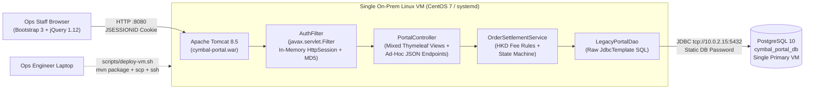

# Cymbal HK — Legacy Merchant & Order Settlement Portal

Monolithic **Java 8 / Spring Boot 2.7 (EOL) / PostgreSQL** web application used by Cymbal HK operations staff to manage Hong Kong retail merchants, track HKD settlement orders, and record manual settlement audits.

> **Scope of this README:** Documents the **existing as-is legacy architecture**, tech stack, database schema, business rules, local execution steps, and manual VM deployment process.

---

## Existing System Architecture



---

## Systems & Tech Stack (As-Is)

| Layer | Current Technology | Version / Notes |
| :--- | :--- | :--- |
| **Language & Runtime** | Java SE | **Java 8 (`1.8`)** source/target (runs on JDK 8–21) |
| **Framework** | Spring Boot (WAR) | **`2.7.18`** (OSS EOL Nov 2023; legacy `javax.*` namespaces) |
| **Application Server** | Apache Tomcat | Tomcat 9 on CentOS 7 VM (deployed as `cymbal-portal.war`) |
| **Database** | PostgreSQL | **PostgreSQL** (`org.postgresql:postgresql` JDBC driver; optional `local` H2 PostgreSQL-mode profile for zero-setup dev) |
| **Data Access** | Spring `JdbcTemplate` | Hand-written SQL strings + manual `RowMapper` in `LegacyPortalDao.java` |
| **Frontend / UI** | Thymeleaf + Bootstrap 3 + jQuery 1.12 | Server-rendered HTML templates (`src/main/resources/templates/`) |
| **Authentication** | Custom `AuthFilter` | Hardcoded operator credentials + in-memory `HttpSession` |
| **Logging** | `System.out.println` + default stdout | Ad-hoc console logging in controllers |
| **Build & Packaging** | Apache Maven | `pom.xml` (`<packaging>war</packaging>`) |
| **Deployment** | Manual Bash Script | `scripts/deploy-vm.sh` (`mvn clean package` → `scp` → `systemctl restart tomcat8`); **no containerization** |
| **Automated Tests** | None | `src/test/` does not exist |

---

## Repository Structure

```text
.
├── README.md                                        # Existing architecture overview (this file)
├── scripts/
│   └── deploy-vm.sh                                 # Manual scp + systemctl WAR deployment script
└── legacy-app/
    ├── pom.xml                                      # Java 8 + Spring Boot 1.5.22 WAR build
    └── src/main/
        ├── resources/
        │   ├── application.properties               # Static DB & admin credentials, port 8080
        │   ├── schema.sql                           # PostgreSQL tables: merchants, merchant_orders, audit_logs
        │   ├── data.sql                             # Seed Hong Kong merchants & sample HKD orders
        │   └── templates/
        │       ├── login.html                       # Bootstrap 3 + jQuery 1.12 login form
        │       ├── dashboard.html                   # Merchant search + order settlement table
        │       └── order-form.html                  # Create new HKD merchant order form
        └── java/com/cymbalhk/portal/
            ├── CymbalPortalApplication.java         # SpringBootServletInitializer (Tomcat WAR entry)
            ├── model/
            │   ├── Merchant.java                    # javax.persistence entity (id, code, name, district, tier)
            │   └── MerchantOrder.java               # javax.persistence entity (HKD amount, fee, status)
            ├── repository/
            │   └── LegacyPortalDao.java             # Raw JdbcTemplate queries & RowMappers
            ├── service/
            │   └── OrderSettlementService.java      # HKD fee calculation, status rules, audit writes
            └── web/
                ├── AuthFilter.java                  # javax.servlet.Filter session gate
                └── PortalController.java            # Monolithic HTML + JSON controller
```

---

## Core Business Rules (`OrderSettlementService.java`)

1. **HKD Settlement Fee Calculation:**
   - **VIP Rate (`1.8%`):** Applied when merchant `tier = 'VIP'` **or** order `amount_hkd >= 50000.00`.
   - **Standard Rate (`2.5%`):** Applied to all other orders.
   - **Minimum Fee Floor:** `HKD 15.00` (if computed percentage is below `15.00`, charge `15.00`).
   - All monetary values rounded `HALF_UP` to 2 decimal places (`net_payout_hkd = amount_hkd - fee_hkd`).
2. **Order Status State Machine:**
   - Valid transitions: `PENDING -> APPROVED`, `APPROVED -> SETTLED`, `PENDING -> CANCELLED`.
   - Invalid transitions (e.g., settling a `CANCELLED` order or cancelling a `SETTLED` order) throw `IllegalStateException`.
3. **Audit Trail:**
   - Every order creation and status transition synchronously inserts a row into `audit_logs` (`order_id`, `action`, `actor`, `details`, `created_at`).

---

## Database Schema (`legacy-app/src/main/resources/schema.sql`)

- **`merchants`:** `id`, `merchant_code` (unique), `name`, `district` (e.g., `Causeway Bay`, `Tsim Sha Tsui`, `Sha Tin`), `tier` (`STANDARD` | `VIP`), `contact_email`, `created_at`.
- **`merchant_orders`:** `id`, `order_ref` (unique), `merchant_id` (FK → `merchants.id`), `amount_hkd`, `fee_hkd`, `net_payout_hkd`, `status` (`PENDING` | `APPROVED` | `SETTLED` | `CANCELLED`), `created_by`, `created_at`, `updated_at`.
- **`audit_logs`:** `id`, `order_id` (FK → `merchant_orders.id`), `action`, `actor`, `details`, `created_at`.

---

## HTTP Endpoints (`PortalController.java`)

| Method & Path | Response Type | Description |
| :--- | :--- | :--- |
| `GET /login`, `POST /login`, `GET /logout` | HTML | Operator login/logout using in-memory `HttpSession` |
| `GET /` / `GET /dashboard?q=` | HTML | Merchant list (with keyword search) + recent HKD orders |
| `GET /orders/new`, `POST /orders` | HTML (redirect) | Create a new HKD merchant order and compute settlement fee |
| `POST /orders/{id}/status` | HTML (redirect) | Advance order status (`APPROVED`, `SETTLED`, `CANCELLED`) |
| `GET /api/merchants?q=` | JSON | Search merchants by name or district |
| `GET /api/orders` | JSON | List all orders with calculated fees and statuses |
| `POST /api/orders` | JSON | Create order programmatically |
| `POST /api/orders/{id}/transition` | JSON | Transition order status programmatically |
| `GET /api/health` | JSON | Basic liveness check |

---

## Running Locally

### Option 1: Against PostgreSQL (Default Profile)
```bash
cd legacy-app
mvn spring-boot:run \
  -Dspring-boot.run.arguments="--spring.datasource.url=jdbc:postgresql://localhost:5432/cymbal_portal_db --spring.datasource.username=cymbal_ops --spring.datasource.password=CymbalLegacyDB!2016"
```

### Option 2: Zero-Setup Local Mode (In-Memory PostgreSQL Compatibility)
```bash
cd legacy-app
mvn spring-boot:run -Dspring-boot.run.profiles=local
```

Open `http://localhost:8080/login` and sign in with `opsadmin` / `cymbal2016`.

---

## Known Legacy Constraints & Technical Debt

- **End-of-life stack:** Java 8 target, Spring Boot 2.7.18 (OSS EOL Nov 2023), legacy `javax.servlet.*` / `javax.persistence.*` namespaces, Bootstrap 3, and jQuery 1.12.
- **Security vulnerabilities:**
  - Hardcoded PostgreSQL password and admin password hash in `application.properties`.
  - Raw SQL string concatenation in `LegacyPortalDao.searchMerchants(keyword)` (SQL injection risk).
  - Weak MD5 password hashing and no CSRF protection.
- **Zero containerization or CI/CD:** Deployed manually via `scp` + `systemctl restart tomcat8` onto a single VM; in-memory `HttpSession` prevents horizontal scaling.
- **Zero automated test coverage:** No unit, contract, or integration tests exist to protect HKD fee calculations during changes.
